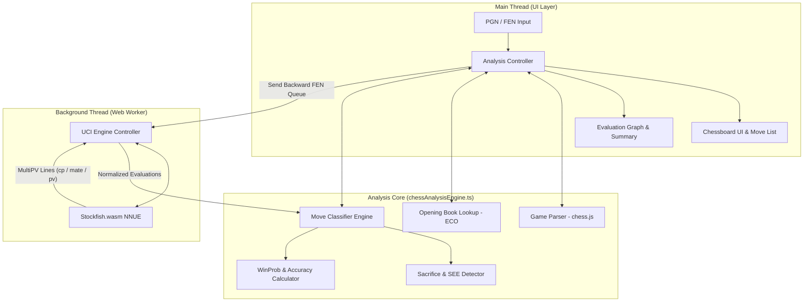

# ♟️ Chess Move Classification & Analysis Architecture

Dokumen ini menjelaskan arsitektur teknis tingkat produksi, alur data, struktur modul, dan algoritma matematis untuk sistem analisis pertandingan dan klasifikasi langkah catur (*Move Classification*) yang akurat.

---

## 1. High-Level System Architecture

Sistem menggunakan pendekatan **Client-Side WebAssembly (Stockfish WASM)** di dalam **Web Worker** agar komputasi mesin catur tidak memblokir *Main Thread* (UI tetap responsif 60 FPS), sekaligus menghilangkan beban biaya komputasi di sisi server.

---

## 2. Pipeline Alur Analisis (Backward Analysis Queue)

Mengapa analisis wajib dilakukan **mundur dari langkah terakhir ke langkah pertama**?
1. **Efisiensi Transposition Table (Hash):** Saat Stockfish mengevaluasi langkah ke-$N$, ia menyimpan pohon pencarian langkah ke-$(N+1)$ di dalam memori Hash. Saat kita mundur ke langkah ke-$(N-1)$, Stockfish sudah mengetahui evaluasi akurat dari langkah lanjutan, sehingga pencarian di `depth 18` menjadi jauh lebih cepat dan akurat.
2. **Deteksi Konteks Langkah Sebelumnya:** Untuk menentukan apakah sebuah langkah adalah **Miss (`❌`)**, sistem perlu mengetahui apakah langkah lawan sebelumnya adalah **Blunder (`??`)**.

### Konfigurasi UCI Standar:
* `uci` -> Pastikan engine siap.
* `setoption name Threads value 2` (Sesuaikan dengan `navigator.hardwareConcurrency`).
* `setoption name Hash value 64` (Alokasi 64 MB untuk Transposition Table).
* `setoption name MultiPV value 2` (**Wajib minimal 2** untuk membandingkan langkah terbaik ke-1 dan ke-2 guna mendeteksi *Great Move*).

---

## 3. Spesifikasi Algoritma & Matematika

### 3.1. Normalisasi Perspektif Evaluasi
UCI Stockfish selalu melaporkan skor (`cp` atau `mate`) dari **sudut pandang pemain yang sedang giliran melangkah pada FEN yang dianalisis**.
* Saat mengevaluasi `fenBefore` (giliran pemain $P$), skor `MultiPV` sudah berada di sudut pandang pemain $P$.
* Saat mengevaluasi `fenAfter` (giliran lawan $O$), skor `MultiPV 1` dari engine adalah sudut pandang lawan. Maka untuk mendapatkan `evalAfter` bagi pemain $P$, skor wajib **dibalik (dikali `-1`)**:
  $$\text{cp}_{\text{after}}^{(P)} = -\text{cp}_{\text{after}}^{(O)}, \quad \text{mate}_{\text{after}}^{(P)} = -\text{mate}_{\text{after}}^{(O)}$$

### 3.2. Konversi Centipawn ke Win Probability ($W$)
Menggunakan model kurva logistik/sigmoid empiris (standar Lichess):

$$W(cp) = \frac{1}{1 + e^{-0.00368208 \cdot \text{clamp}(cp, -1000, 1000)}}$$

* Jika $\text{mate} > 0$, maka $W = 1.0 - (\text{mate} \times 0.001)$ *(memberi insentif memilih mate paling singkat)*.
* Jika $\text{mate} < 0$, maka $W = 0.0 + (|\text{mate}| \times 0.001)$.
* **Expected Points Lost ($\Delta W$):**
  $$\Delta W = \max(0, W_{\text{before}} - W_{\text{after}})$$

---

## 4. Matriks & Decision Tree Klasifikasi Langkah

Urutan pengecekan harus dieksekusi dari atas ke bawah:

| Prioritas | Klasifikasi | Simbol | Syarat Logika Akurat |
| :---: | :--- | :---: | :--- |
| **1** | **Forced** | ⚪ | Jumlah langkah legal pada `fenBefore` == `1`. |
| **2** | **Book** | 📖 | `fenAfter` terdaftar di database ECO Opening Book (dan `ply <= 24`). |
| **3** | **Brilliant** | `!!` | Langkah adalah Top Move ($\Delta W \le 0.015$ atau `played == best`), `isSacrifice == true`, posisi belum menang telak ($W_{\text{before}} < 0.88$), dan setelah melangkah posisi tetap bagus ($W_{\text{after}} \ge 0.40$). |
| **4** | **Great** | `!` | Langkah adalah `#1 bestMove` mutlak di mana selisih keunggulan terhadap kandidat ke-2 sangat besar ($W_{\text{before}} - W_{\text{secondBest}} \ge 0.15$), serta bukan di posisi yang sudah menang telak ($0.25 \le W_{\text{after}} \le 0.90$). |
| **5** | **Best** | ⭐ | `playedUci === bestUci` (HANYA langkah pilihan nomor 1 Stockfish; langkah alternatif yang bagus masuk ke Excellent). |
| **6** | **Miss** | ❌ | Langkah lawan sebelumnya adalah `Blunder` atau `Mistake` ($\Delta W_{\text{prev}} \ge 0.12$), namun pemain gagal memanfaatkannya ($\Delta W > 0.12$ dan bukan karena masuk ke mate lawan). |
| **7** | **Blunder (Mate)** | `??` | Membuang *Forced Mate* ($\text{mate}_{\text{before}} > 0 \rightarrow \text{mate}_{\text{after}} == \text{null}$ dan $W_{\text{after}} < 0.75$) ATAU melangkah masuk ke *Forced Mate* lawan ($\text{mate}_{\text{before}} == \text{null} \rightarrow \text{mate}_{\text{after}} < 0$). |
| **8** | **Excellent** | 👍 | Bukan pilihan #1 engine (`playedUci !== bestUci`), namun langkah alternatif yang sangat kuat ($\Delta W \le 0.025$). |
| **9** | **Good** | ✔️ | $0.025 < \Delta W \le 0.055$ |
| **10** | **Inaccuracy** | `?!` | $0.055 < \Delta W \le 0.105$ |
| **11** | **Mistake** | `?` | $0.105 < \Delta W \le 0.20$ |
| **12** | **Blunder** | `??` | $\Delta W > 0.20$ |

---

## 5. Algoritma Deteksi Pengorbanan Materi (Sacrifice Detector)

Sebuah langkah dikategorikan sebagai pengorbanan (`isSacrifice = true`) menggunakan analisis papan `chess.js` dan *Static Exchange Evaluation* (SEE) sederhana:

1. **Bobot Materi:** Pion = `100`, Kuda = `300`, Gajah = `300`, Benteng = `500`, Menteri = `900`.
2. **Skenario Pengorbanan Langsung (Direct Capture Sacrifice):**
   Pemain menggerakkan perwira bernilai $V_{\text{moved}}$ (minimal Kuda/Gajah $\ge 300$) ke petak $S$ (memakan bidak lawan bernilai $V_{\text{captured}}$, bisa $0$ jika petak kosong), dan pada langkah berikutnya lawan dapat memakan balik di petak $S$ menggunakan penyerang bernilai $V_{\text{attacker}}$ di mana:
   * $V_{\text{moved}} - V_{\text{captured}} \ge 200$ (rugi minimal seharga kualitas/perwira), **DAN**
   * Petak $S$ tidak dilindungi oleh kita, ATAU $V_{\text{attacker}} < V_{\text{moved}} - V_{\text{captured}}$ (penyerang lawan jauh lebih murah sehingga pertukaran lanjutan tetap merugikan kita secara materi).
3. **Skenario Pengorbanan Tidak Langsung (Leaving a Piece Hanging / Greek Gift / Discovery):**
   Pemain melangkahkan bidak A, sembari dengan sengaja membiarkan perwira B (Kuda/Gajah/Benteng/Menteri) di petak lain tetap diserang oleh bidak lawan yang lebih murah atau tanpa pelindung (*hanging*), padahal pada posisi sebelumnya pemain bisa saja menyelamatkan perwira B tersebut.

---

## 6. Kalkulasi Akurasi Pertandingan (Move & Game Accuracy)

### 6.1. Akurasi per Langkah ($A_i$)
Berdasarkan persentase penurunan peluang menang $w_{\text{loss}} = \Delta W \times 100$:

$$A_i = \text{clamp}\left(103.1668 \cdot e^{-0.04354 \cdot w_{\text{loss}}} - 3.1669, \; 0, \; 100\right)$$

### 6.2. Akurasi Total Permainan ($A_{\text{game}}$)
Menggabungkan **Volatility-Weighted Mean** (langkah pada posisi kritis/tegang memiliki bobot lebih tinggi) dan **Harmonic Mean** (menghukum *blunder* berulang secara proporsional):

$$A_{\text{game}} = \frac{\text{WeightedMean}(A) + \text{HarmonicMean}(A)}{2}$$